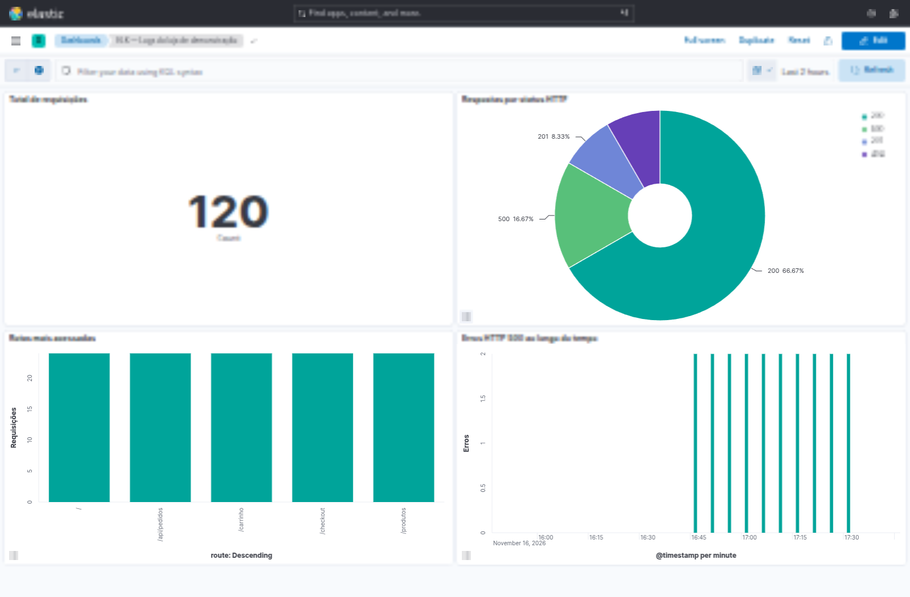

# ELK com Vagrant

Laboratório acadêmico de centralização de logs. O comando `vagrant up` cria uma VM Ubuntu, instala Docker e Compose, inicia **Elasticsearch, Logstash e Kibana** e prepara os dados e o dashboard da demonstração.

**Repositório:** https://github.com/Dynylson/elk-vagrant

**Estado dos testes:** integração ELK validada com Docker e configuração geral validada com Vagrant 2.4.9. A criação da VM com VirtualBox ainda precisa ser testada em uma máquina com esse provedor instalado. Consulte as [evidências de validação](docs/VALIDACAO.md).

## Arquitetura

```text
Máquina anfitriã
  Navegador: localhost:5601
       │ encaminhamento de porta, restrito ao localhost
       ▼
  VM Ubuntu 24.04 — criada e provisionada pelo Vagrant
    ┌───────────────────────────────────────────────────────────┐
    │ application.log → Logstash → Elasticsearch ← Kibana       │
    │                   transforma   armazena       consulta     │
    └───────────────────────────────────────────────────────────┘
```

Vagrant gerencia a VM; Docker Compose executa os serviços **dentro dela**. Docker não precisa estar instalado no computador de quem usa o Vagrant.

As imagens dos três produtos estão fixadas em **8.19.12**. A VM usa a box `bento/ubuntu-24.04`, versão `202510.26.0`. Não são usadas tags `latest`. A instalação de Docker recebe os pacotes disponíveis no repositório oficial no momento do provisionamento.

## Pré-requisitos

- Computador **x86_64/AMD64** com virtualização habilitada no BIOS/UEFI. O fluxo documentado usa VirtualBox; Apple Silicon não está contemplado.
- [Vagrant](https://developer.hashicorp.com/vagrant/install), versão 2.4 ou superior.
- [VirtualBox](https://www.virtualbox.org/wiki/Downloads), em versão compatível com o Vagrant e o sistema anfitrião.
- Git e `rsync` disponíveis no terminal. O compartilhamento usa `rsync`, sem depender de Guest Additions. No Windows, disponibilize também `rsync` no PATH utilizado pelo Vagrant.
- **6 GB de RAM e 2 CPUs disponíveis para a VM**; recomendamos um computador com pelo menos 16 GB de RAM e 20 GB livres em disco.
- Internet no primeiro provisionamento para baixar a box, os pacotes e as imagens.
- Portas locais `5601` e `9200` disponíveis.

## Subir o ambiente

```bash
git clone https://github.com/Dynylson/elk-vagrant.git
cd elk-vagrant
vagrant up --provider=virtualbox
```

Nas próximas inicializações, basta `vagrant up`. A primeira execução pode levar vários minutos, principalmente pelos downloads. Aguarde a mensagem `Laboratório pronto` e as linhas `VALIDADO`.

O provisionamento:

1. Instala Docker e o plugin Compose a partir do repositório oficial.
2. Ajusta `vm.max_map_count` na VM para `1048576`.
3. Copia o projeto para `/opt/elk-vagrant`.
4. Gera 120 acessos fictícios com timestamps recentes.
5. Inicia Elasticsearch e Kibana e configura o template dos índices.
6. Inicia o Logstash para processar o arquivo de logs.
7. Importa o data view e quatro visualizações em um dashboard.
8. Verifica a quantidade, a distribuição dos eventos e os objetos do Kibana.

## Acessar

Captura real do dashboard no Kibana, com os 120 eventos fictícios processados pelo Logstash:



| Recurso | Endereço |
| --- | --- |
| Kibana | http://localhost:5601 |
| Dashboard da demonstração | http://localhost:5601/app/dashboards#/view/elk-lab-dashboard |
| Elasticsearch | http://localhost:9200 |

**Não há usuário ou senha.** A autenticação está desabilitada para este laboratório local, e os encaminhamentos do Vagrant escutam apenas em `127.0.0.1`. Não adicione rede pública, não publique essas portas na internet e não use essa configuração em produção. Os eventos são fictícios, com IPs da faixa de documentação `192.0.2.0/24`.

## Demonstração para a apresentação

1. Mostre o `Vagrantfile` e explique a criação da VM com 6 GB e 2 CPUs.
2. Execute `vagrant status` e mostre os serviços:

   ```bash
   vagrant ssh -c 'cd /opt/elk-vagrant && sudo docker compose ps'
   ```

3. Abra o dashboard. Ele contém **total de requisições**, **respostas por status HTTP**, **rotas mais acessadas** e **erros HTTP 500 ao longo do tempo**.
4. Em **Discover**, selecione o data view `elk-lab-*` e use a consulta KQL:

   ```text
   status_code: 500
   ```

5. Mostre um evento e seus campos: `@timestamp`, `client_ip`, `http_method`, `route`, `status_code`, `response_time_ms`, `service` e `message`. O campo `event.original` preserva a linha que chegou ao Logstash.
6. Compare com `examples/application.log` e explique o pipeline `input → filter → output` em `logstash/pipeline.conf`. Os timestamps do arquivo de referência diferem dos dados gerados na VM.
7. Mostre a consulta ao Elasticsearch:

   ```bash
   curl 'http://localhost:9200/elk-lab-logs/_count?pretty'
   curl -H 'Content-Type: application/json' \
     'http://localhost:9200/elk-lab-logs/_search?pretty' \
     -d '{"size":1,"query":{"term":{"status_code":500}}}'
   ```

### Resultado esperado

| Status HTTP | Eventos |
| --- | ---: |
| 200 | 80 |
| 201 | 10 |
| 404 | 10 |
| 500 | 20 |
| **Total** | **120** |

São dados sintéticos para demonstrar ingestão e busca, não medições de uma aplicação real. As cinco rotas possuem 24 acessos cada; o gráfico por rota serve para demonstrar a agregação.

O dashboard começa no intervalo **últimas 24 horas**. Os dados são gerados uma vez e persistidos. Se abrir o ambiente dias depois, amplie o período no Kibana para incluir a data da primeira execução. Para uma demonstração inteiramente nova, destrua e recrie a VM.

## Verificar, parar e remover

```bash
# Conferir dados, data view e dashboard.
vagrant ssh -c 'cd /opt/elk-vagrant && sudo python3 scripts/bootstrap.py verify'

# Desligar a VM, preservando os dados.
vagrant halt

# Ligar novamente. Os serviços iniciam automaticamente pelo Docker.
vagrant up

# Tentar novamente o provisionamento após uma falha.
vagrant provision

# Remover a VM e todos os dados do laboratório.
vagrant destroy -f
```

O `sincedb` do Logstash persiste a posição de leitura do arquivo. Além disso, o ID de cada documento é um hash da linha original, evitando duplicação ao reprocessar o mesmo evento. Reprovisionar preserva o arquivo gerado e reimporta os objetos do Kibana, substituindo alterações feitas no dashboard fornecido.

Se editar arquivos do projeto, sincronize antes de reprovisionar:

```bash
vagrant rsync
vagrant provision
```

## Arquivos do projeto

```text
Vagrantfile                    VM, recursos, rede e provisionamento
compose.yaml                   Serviços, volumes, limites e healthchecks
provision/setup.sh             Instalação e inicialização dentro da VM
scripts/start.sh               Sequência de inicialização do laboratório
scripts/generate_logs.py       Geração dos 120 logs fictícios
scripts/bootstrap.py           Template, importação e verificações HTTP
logstash/pipeline.conf         Leitura, parsing, conversão e envio dos logs
kibana/saved-objects.ndjson    Data view, visualizações e dashboard
examples/application.log       Exemplo do formato de entrada
docs/VALIDACAO.md              Evidências e limites dos testes realizados
.github/workflows/validate.yml Verificação automatizada da stack
```

## Solução de problemas

**Porta ocupada:** libere `5601`/`9200` ou altere os valores `host:` no `Vagrantfile`. A porta `guest:` permanece igual. O encaminhamento não escolhe outra porta silenciosamente.

**VirtualBox não inicia:** confirme a virtualização no BIOS/UEFI e a instalação do driver do VirtualBox. No Linux, Secure Boot pode exigir assinatura dos módulos. Em ambientes que já são VMs, a virtualização aninhada precisa estar disponível.

**`rsync` não encontrado:** instale-o no anfitrião e confirme com `rsync --version` no mesmo terminal em que executa Vagrant.

**Falha de download ou provisionamento:** verifique a conexão e execute `vagrant provision`. O estado existente será preservado.

**Kibana sem dados:** ajuste o período de tempo e selecione `elk-lab-*`. Confirme os eventos com `_count` e consulte o Logstash:

```bash
vagrant ssh -c 'cd /opt/elk-vagrant && sudo docker compose logs --tail=100 logstash'
vagrant ssh -c 'cd /opt/elk-vagrant && sudo docker compose logs --tail=100 kibana'
vagrant ssh -c 'cd /opt/elk-vagrant && sudo docker compose ps -a'
```

**Saída 137 ou serviços reiniciando:** pode faltar memória. Libere recursos no anfitrião ou aumente a memória da VM no `Vagrantfile` e execute `vagrant reload`.

**A verificação não encontra exatamente 120 eventos:** a verificação foi feita para a base original. Logs adicionais alteram a contagem esperada. Recrie a VM para retornar ao estado inicial.

## Alternativa para desenvolvimento: Docker direto

Esta alternativa permite testar a stack sem VM. **A entrega principal continua sendo o Vagrant.** Requer Docker Engine com Compose e Python 3 no anfitrião. Em Linux, confirme `sysctl vm.max_map_count`; o valor necessário é pelo menos `1048576`. O provisionamento Vagrant faz esse ajuste somente dentro da VM.

```bash
cp .env.example .env
bash scripts/start.sh
python3 scripts/bootstrap.py verify
docker compose down
```

O `.env` permite escolher outras portas para desenvolvimento. Para apagar também os dados dessa alternativa, use `docker compose down -v`. Para gerar uma base nova depois disso, remova `.runtime/application.log` antes de iniciar novamente.

## Referências

- [Visão geral da Elastic Stack](https://www.elastic.co/docs/get-started/the-stack)
- [Elasticsearch 8.19 com Docker](https://www.elastic.co/guide/en/elasticsearch/reference/8.19/docker.html)
- [Requisito de memória virtual](https://www.elastic.co/docs/deploy-manage/deploy/self-managed/vm-max-map-count)
- [Plugin de entrada de arquivos do Logstash](https://www.elastic.co/guide/en/logstash/8.19/plugins-inputs-file.html)
- [Objetos salvos do Kibana](https://www.elastic.co/docs/explore-analyze/find-and-organize/saved-objects)
- [Provisionamento com Vagrant](https://developer.hashicorp.com/vagrant/docs/provisioning)
- [Instalação oficial do Docker no Ubuntu](https://docs.docker.com/engine/install/ubuntu/)

O código de automação deste repositório está sob a licença MIT. Elasticsearch, Logstash, Kibana, Vagrant, VirtualBox e a box possuem seus próprios termos e licenças.
